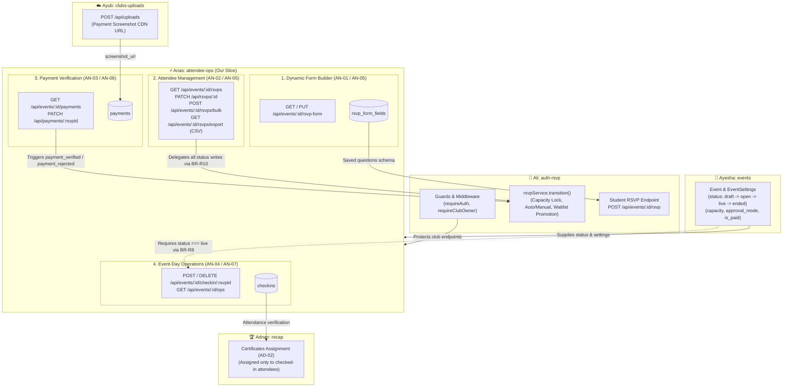
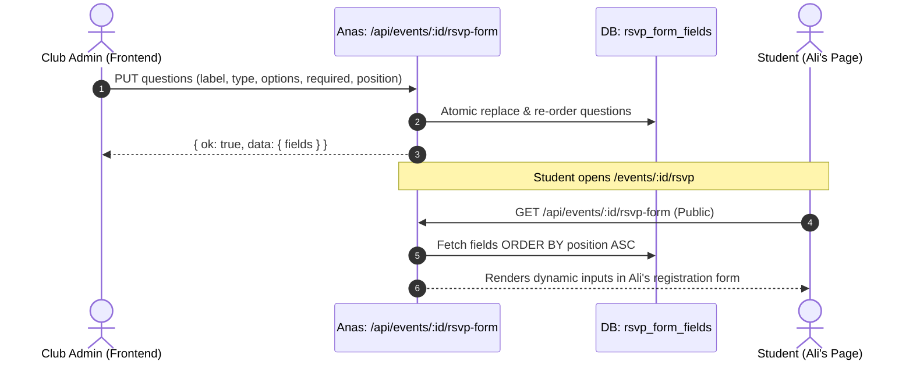
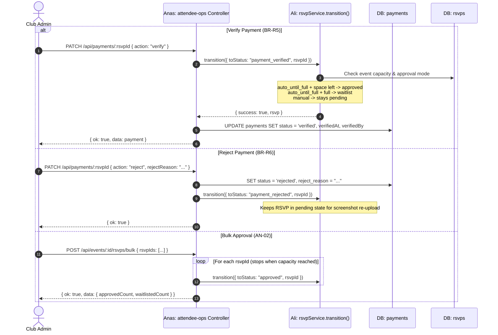
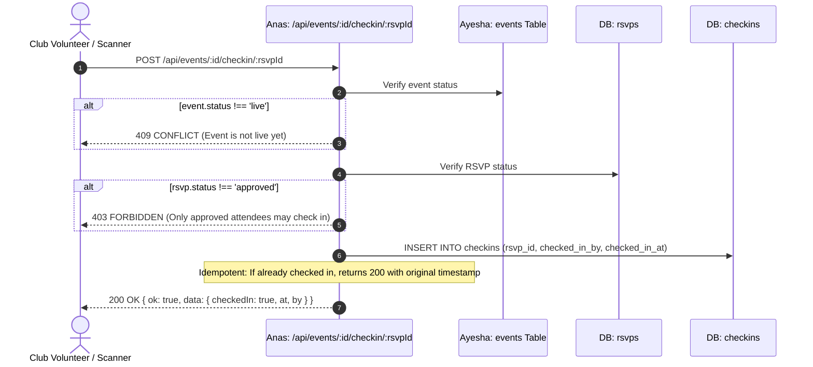

# Attendee Operations, Payments & Event-Day Architecture (AN-01 - AN-07)

**Slice Owner:** Anas (`attendee-ops`)  
**Target Branch:** `dev`  
**Peer Review Ring:** Reviewed by **Ayesha** | Anas reviews **Ayub**

---

## 1. High-Level Architecture & Teammate Integration

The `attendee-ops` slice sits at the core of event lifecycle operations — bridging student RSVPs, club host decisions, payment verification, and day-of check-ins:



---

## 2. Teammate Dependencies Matrix

| Teammate | What Anas Needs from Them (Inbound) | What They Need from Anas (Outbound) |
|---|---|---|
| **Ali** (`auth-rsvp`) | 1. **`requireAuth` & `requireClubOwner`** route guards.<br/>2. **`AL-02` Migration**: Base tables (`users`, `rsvps`, `events`, `clubs`) and `options Json?` on `rsvp_form_fields`.<br/>3. **`rsvpService.transition()` (BR-R10)**: All attendee status updates (`approved`, `rejected`, `waitlist`, `payment_verified`, `payment_rejected`) must delegate here to preserve capacity lock and FIFO waitlist promotions. | 1. **Dynamic Questions (`GET /api/events/:id/rsvp-form`)**: Ali's student RSVP submission (`POST /api/events/:id/rsvp`) reads Anas's custom questions to validate and save student responses in `rsvps.answers` (jsonb).<br/>2. **Payment Trigger**: Anas's payment verification triggers Ali's auto/manual approval rules. |
| **Ayesha** (`events`) | 1. **`event.status`**: Check-in (`POST /api/events/:id/checkin/:rsvpId`) strictly requires `event.status === 'live'` (**BR-R8**).<br/>2. **`event_settings`**: `capacity` and `approval_mode` (`auto_until_full` \| `manual`) used to validate bulk approvals. | 1. **Real-time Ops Counts (`GET /api/events/:id/ops`)**: Provides `registeredCount`, `approvedCount`, and `checkedInCount` for the live event dashboard and control room. |
| **Ayub** (`clubs-uploads`) | 1. **`POST /api/uploads`**: Students upload payment proof through Ayub's upload service; the resulting URL is stored in `payments.screenshot_url` and reviewed in Anas's payment queue. | 1. Peer review: Anas conducts code reviews for Ayub's pull requests. |
| **Adnan** (`recap`) | — | 1. **`checkins` Table**: Adnan's certificate assignment engine (**AD-02 / BR-P4**) inspects Anas's `checkins` table to ensure certificates are only issued to students who physically checked in. |

---

## 3. Core Operational Flows

### Flow 1: Dynamic RSVP Form Builder (AN-01 & AN-05)

Clubs configure custom survey questions (e.g., T-shirt size, dietary needs, GitHub handles); Ali's student registration loads them dynamically:



---

### Flow 2: Attendee Status & Payment Queue (AN-02, AN-03, BR-R5, BR-R6, BR-R10)

Per **BR-R10**, `attendee-ops` never touches `rsvps.status` directly. It delegates to Ali's `rsvpService.transition()`, ensuring capacity is never oversold:



---

### Flow 3: Event-Day Live Check-in & Metrics (AN-04 & AN-07, BR-R8)

Enforces event lifecycle gatekeeping and idempotent check-ins:



---

## 4. Database Schema Ownership

Defined in `backend/prisma/schema.prisma`:

```prisma
model RsvpFormField {
  id        String        @id @default(uuid()) @db.Uuid
  eventId   String        @map("event_id") @db.Uuid
  label     String
  type      RsvpFieldType
  required  Boolean       @default(false)
  position  Int           @default(0)
  options   Json?         // Supported for select & checkbox (min 2 items)

  event     Event         @relation(fields: [eventId], references: [id], onDelete: Cascade)

  @@index([eventId, position])
  @@map("rsvp_form_fields")
}

model Payment {
  id            String        @id @default(uuid()) @db.Uuid
  rsvpId        String        @unique @map("rsvp_id") @db.Uuid
  screenshotUrl String        @map("screenshot_url")
  status        PaymentStatus @default(pending)
  rejectReason  String?       @map("reject_reason")
  verifiedBy    String?       @map("verified_by") @db.Uuid
  verifiedAt    DateTime?     @map("verified_at")
  createdAt     DateTime      @default(now()) @map("created_at")

  rsvp          Rsvp          @relation(fields: [rsvpId], references: [id], onDelete: Cascade)

  @@map("payments")
}

model Checkin {
  id          String   @id @default(uuid()) @db.Uuid
  rsvpId      String   @unique @map("rsvp_id") @db.Uuid
  checkedInAt DateTime @default(now()) @map("checked_in_at")
  checkedInBy String   @map("checked_in_by") @db.Uuid

  rsvp        Rsvp     @relation(fields: [rsvpId], references: [id], onDelete: Cascade)

  @@map("checkins")
}
```

---

## 5. Endpoints Overview (11 Total)

| Endpoint | Method | Role / Guard | Description |
|---|---|---|---|
| `/api/events/:id/rsvp-form` | `GET` | Public | Fetch custom form questions sorted by position |
| `/api/events/:id/rsvp-form` | `PUT` | `requireClubOwner` | Create or update custom RSVP questions |
| `/api/events/:id/rsvps` | `GET` | `requireClubOwner` | List attendees with pagination & status filters |
| `/api/rsvps/:id` | `PATCH` | `requireClubOwner` | Transition single attendee status (`approved`, `rejected`, `waitlist`) |
| `/api/events/:id/rsvps/bulk` | `POST` | `requireClubOwner` | Atomic bulk approval up to event capacity |
| `/api/events/:id/rsvps/export` | `GET` | `requireClubOwner` | Streamed CSV attendee export with RFC 4180 escaping |
| `/api/events/:id/payments` | `GET` | `requireClubOwner` | Club payment verification queue |
| `/api/payments/:rsvpId` | `PATCH` | `requireClubOwner` | Verify or reject payment screenshot with reason |
| `/api/events/:id/checkin/:rsvpId` | `POST` | `requireClubOwner` | Mark attendee present (event must be live) |
| `/api/events/:id/checkin/:rsvpId` | `DELETE` | `requireClubOwner` | Revert accidental check-in |
| `/api/events/:id/ops` | `GET` | `requireClubOwner` | Real-time counts (`registered`, `approved`, `checkedIn`) |
